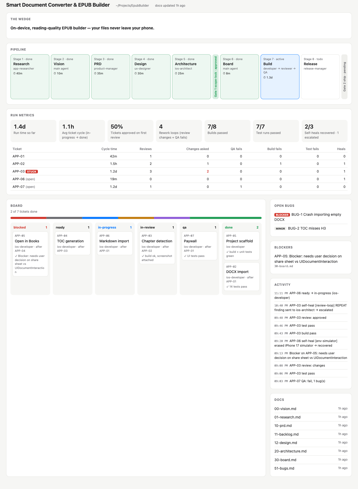

# Murad iOS Studio (`murad-ios-studio`)

Repo: https://github.com/rxalimurad-art/murad-ios-studio

A **studio of specialist agents** taking an iOS app from a one-line idea to the App Store. You
give the idea and approve two gates — the studio handles the hundred steps in between. Works as
a native plugin in Claude Code, Kimi Code, Codex CLI, and Gemini CLI.

```
idea → research → PRD → design → architecture → build → review/QA → TestFlight → App Store
            ▲ GATE 1: scope-lock (you approve the plan) ▲        ▲ GATE 2: ship (you confirm) ▲
```

## Prerequisites

- macOS 14.5+, Xcode 16+, Node.js 18+ (for MobileBuildMCP, installed automatically via `npx`)
- Optional, for the deploy stage: `brew install fastlane`
- An Apple Developer account (paid) for TestFlight/App Store submission

Building and testing need only the first line. To ship, also do the one-time setup in
[What you need to do](#what-you-need-to-do).

## Install

From the GitHub repo (Claude Code 2.1.275+, one step):

```
/plugin install murad-ios-studio --marketplace rxalimurad-art/murad-ios-studio
```

On older versions, add the marketplace first:

```
/plugin marketplace add rxalimurad-art/murad-ios-studio
/plugin install murad-ios-studio@murad-studio
```

Or from a local clone of this directory:

```
/plugin marketplace add /Users/alimurad/Documents/GitHub/murad-ios-studio
/plugin install murad-ios-studio@murad-studio
```

> Note: installing from the GitHub repo requires it to be **public** (the plugin manager clones
> without auth). While it's private, use the local-path install above.

The plugin ships the `mobilebuildmcp` MCP server; approve it when Claude Code prompts on first
use, and check it with `/mcp`.

### Kimi Code

The repo keeps both manifests — `.claude-plugin/plugin.json` for Claude Code and
`kimi.plugin.json` for Kimi Code — and the agent/skill frontmatter carries both spellings
(`when_to_use` + `whenToUse`, `WebFetch` + `FetchURL`), so the same checkout installs in either:

```
/plugins install https://github.com/rxalimurad-art/murad-ios-studio
/reload
```

### Codex CLI

This repo is also a valid Codex plugin (`.codex-plugin/plugin.json`). Codex has no slash
commands or named subagents, so every command and agent is exposed as a skill instead
(`$app-run`, `$app-init`, `$ios-developer`, etc. — see [Running on Codex/Gemini](#running-on-codexgemini-vs-claude-codekimi-code) below).

```
codex plugin marketplace add /Users/alimurad/Documents/GitHub/murad-ios-studio
codex plugin add murad-ios-studio
```

(swap the local path for `rxalimurad-art/murad-ios-studio` to install straight from GitHub).

### Gemini CLI

This repo is also a valid Gemini CLI extension (`gemini-extension.json`), with the same six
pipeline stages (plus `app-dashboard`) exposed both as skills and as `/`-style TOML commands under `commands/*.toml`
(`/app-run`, `/app-init`, …).

```
gemini extensions install https://github.com/rxalimurad-art/murad-ios-studio
```

## Running on Codex/Gemini vs. Claude Code/Kimi Code

Claude Code and Kimi Code dispatch each specialist as an isolated subagent. Codex CLI and
Gemini CLI have no equivalent for custom named subagents, so there the same 9 roles and 6
pipeline stages are exposed as **skills** (`skills/app-researcher`, `skills/app-init`, …) that
each do one thing: read the canonical instructions in `agents/*.md` or `commands/*.md` and
follow them in the current thread instead of a separate context. The pipeline contract itself
(stages, the two gates, the board format, verify-before-done) is identical on every runtime —
see the `studio-pipeline` skill. Gemini additionally gets `commands/*.toml` wrappers so the six
stages also show up as native `/`-commands there.

`agents/`, `commands/`, and `skills/` are the source of truth; the bridge skills under `skills/`
just point at them, so there's one place to edit the actual studio behavior.

## Quickstart

From an **empty project folder**:

```
/murad-ios-studio:app-run A habit tracker for new parents with streaks and reminders
```

Or drive the stages manually:

```
/murad-ios-studio:app-init <idea>     # research → vision → PRD → design → architecture docs
/murad-ios-studio:app-plan            # PRD/backlog → sprint board (docs/30-board.md)
/murad-ios-studio:app-build           # loop: developers → reviewer → QA until board is done
/murad-ios-studio:app-status          # standup: board state, blockers, next steps
/murad-ios-studio:app-ship [version]  # release assets → TestFlight → (gate) → App Store
/murad-ios-studio:app-dashboard [port] # live web dashboard of the project (default :4777)
```

## What you need to do

The studio automates the work in between, but a few things only you can do: Apple account
setup, a handful of App Store Connect pages, and the two gates. Everything not listed here is
done by the agents.

### Once per Mac

1. Install Xcode 16+ and sign in with your Apple ID (Xcode → Settings → Accounts).
2. Install Node.js 18+ and fastlane: `brew install node fastlane`.
3. Install the plugin (see [Install](#install)) and approve the `mobilebuildmcp` server the first
   time it's used.

### Once per Apple account

1. **Join the Apple Developer Program** ($99/year) at developer.apple.com.
2. **Agreements, Tax, and Banking** (App Store Connect → Business): accept the Paid Apps
   agreement and fill in tax and bank details. Required before you can sell anything, including
   in-app purchases; a free app needs only the free agreement.
3. **Create an App Store Connect API key** (App Store Connect → Users and Access → Integrations →
   App Store Connect API → Team Keys) with the **Admin** role — Xcode needs it to create your
   distribution certificate automatically. (App Manager also works if you tick "Access to Cloud
   Managed Distribution Certificate" for it.) Download the `.p8` file (Apple only lets you download it once) and note its Key ID
   and the Issuer ID shown on that page.
4. **Find your Team ID**: developer.apple.com → Account → Membership details (10 characters).
5. **Store the secrets outside any repo** — put the `.p8` in `~/.appstoreconnect/` and add to
   `~/.zshrc`:

   ```sh
   export APP_STORE_CONNECT_API_KEY_KEY_ID=XXXXXXXXXX
   export APP_STORE_CONNECT_API_KEY_ISSUER_ID=xxxxxxxx-xxxx-xxxx-xxxx-xxxxxxxxxxxx
   export APP_STORE_CONNECT_API_KEY_KEY_FILEPATH=~/.appstoreconnect/AuthKey_XXXXXXXXXX.p8
   export APPLE_TEAM_ID=XXXXXXXXXX
   ```

   Signing is handled by Xcode automatic signing using this key: no certificates repo, no
   profiles to manage, and nothing to click in Xcode.

### Once per app

1. **Register the bundle ID** (developer.apple.com → Certificates, Identifiers & Profiles →
   Identifiers), using the one agreed at GATE 1, e.g. `com.yourname.appname`. App Store Connect
   needs it to exist before you can create the app record in the next step.
2. **Create the app record** in App Store Connect (Apps → + → New App: name, primary language,
   that bundle ID, any SKU). Apple's API doesn't allow this with a key.
3. **Host two web pages**: a privacy policy and a support page. They must be live URLs; the
   agents draft the text, you publish it (GitHub Pages or any site works).
4. **Fill in App Privacy** (your app → App Privacy) from the data-collection list the release
   manager writes in `docs/60-release.md`. This page also can't be set with an API key.
5. **Set price and availability** (your app → Pricing and Availability).
6. **If the app sells anything**, create each in-app purchase in App Store Connect with the
   product ID the code uses (the release manager lists them), its price, and a review screenshot.
7. **If the app has a login**, give the studio a demo account for Apple's reviewers.

### During every run

1. **GATE 1 — scope-lock**: read the summary (idea, MVP, architecture, icon) and approve or revise.
2. **Answer blockers**: anything the agents can't decide shows up in their messages and on the
   dashboard's Blockers panel. The line stops until you answer.
3. **Try the TestFlight build** on your own iPhone (TestFlight app) before shipping.
4. **GATE 2 — ship**: check the screenshots, store text, release notes, and version in the
   readiness summary, then confirm the upload.
5. **After submission**: App Review emails you. If the app is rejected, paste Apple's message
   into the session; the studio fixes what it can, and you reply to Apple in App Store Connect.
6. **Update App Privacy** whenever the app starts collecting new data.

### What runs without you

Research, PRD, design, icon, architecture, code, tests, review, QA, signing (Xcode automatic
signing), build numbers, archiving, TestFlight upload and testers, screenshots, store text in
every language, age rating, export-compliance answers, submission for review, and release after
approval — all driven by the agents, with uploads waiting for your GATE 2 confirmation.

## Dashboard



`/murad-ios-studio:app-dashboard` starts a small local server (`dashboard/server.mjs`, Node only,
no dependencies) and gives you `http://localhost:4777`. Keep it open while the pipeline runs: it
re-reads your project's `docs/` every few seconds and shows

- the 8 stages and both gates, with what's done, active, or waiting on you
- the ticket board from `docs/30-board.md` as columns by status, with each ticket's evidence
- open bugs from `docs/51-bugs.md` (blockers first) and every blocker agents flagged for you
- every doc, rendered in a viewer

- run metrics from `docs/90-telemetry.jsonl`: time per stage, cycle time per ticket, first-pass
  review rate, rework loops, build/test pass rates, and a live activity feed

**Telemetry is local only.** Agents append one JSON line per event (stage start/end, gate
decisions, ticket moves, build/test results, review and QA verdicts) to `docs/90-telemetry.jsonl`
in your project; the format is in the `studio-pipeline` skill. Nothing is sent anywhere. When the
log has gate decisions, the dashboard uses them instead of guessing gate state from which docs
exist.

It's read-only — it never writes to `docs/`. You can also run it directly from a project folder:
`node <plugin-root>/dashboard/server.mjs . --port 4777`.

## The team

Dispatched as a subagent on Claude Code/Kimi Code, run in-thread as a skill on Codex/Gemini CLI.

| Agent | Role |
| --- | --- |
| `app-researcher` | Validates the idea: competitors, App Store category, positioning |
| `product-manager` | PRD, user stories, MVP scope |
| `ux-designer` | Flows, screen inventory, design tokens, SwiftUI-ready specs |
| `icon-designer` | App icon concept and SVG masters (light/dark/tinted), rendered and validated as `AppIcon.appiconset` |
| `ios-architect` | Stack, SPM modules, ADRs, git/CI strategy |
| `ios-developer` | Implements features; builds/tests on the simulator via MobileBuildMCP |
| `code-reviewer` | The merge gate — concurrency, accessibility, security, data-path defects |
| `qa-engineer` | Test plans, XCUITest, bug filing, ship sign-off |
| `release-manager` | fastlane, signing, screenshots, metadata, TestFlight, submission |

## How it stays honest

- **Docs are the source of truth.** Everything lands in `docs/` in your project
  (`00-vision`, `01-research`, `10-prd`, `12-design`, `13-icon`, `20-architecture`, `30-board`,
  `50-test-plan`, `51-bugs`, `60-release`). Every agent reads them before acting.
- **Nothing is "done" on an agent's say-so.** A ticket moves to review only after the
  build compiles and tests exit zero on a real simulator run.
- **It heals before it retries.** Every failure is classified (simulator, MobileBuildMCP, stale
  caches, packages, compile, flaky vs. real test, repeated review finding, stuck or interrupted
  ticket) and gets its own recovery with a retry budget, escalating to the architect or to you
  instead of looping. Signing and App Store Connect problems are never auto-healed. Rules are in
  the `studio-pipeline` skill; every recovery shows up on the dashboard.
- **Ambiguity stops the line.** Agents write blockers into the board/standup and ask you
  instead of guessing.

## Roadmap (not in v1)

Brownfield onboarding/audit for existing apps, parallel worktree isolation for developers,
Android/backend roles, control-room dashboard. Design concepts adapted from
[vmobifystudio/app-dev-team](https://github.com/vmobifystudio/app-dev-team) (MIT) — see
`THIRD_PARTY_NOTICES.md`.
